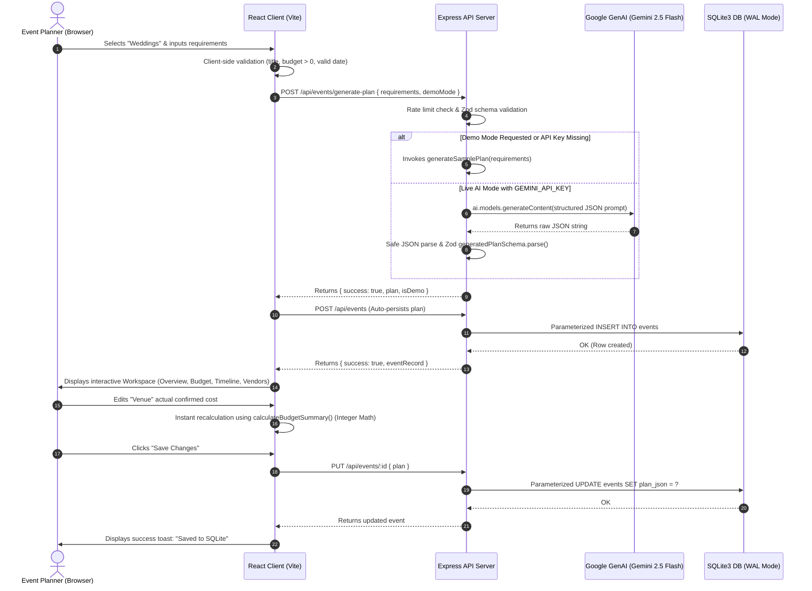

# CelebrAI — Architecture & Technical Design Document
## PromptWars Virtual Challenge 5 | Production-Ready Blueprint

This document details the software architecture, data flow, entity relationships, security models, and design patterns implemented in **CelebrAI — Your Intelligent Event Planner**.

---

## 1. System Overview & Technology Stack

CelebrAI is designed as a lightweight, secure, and production-ready event planning platform:

```
+--------------------------------------------------------------------------+
|                        CelebrAI Frontend (React + Vite)                  |
|  - React 18, TypeScript, Tailwind CSS, Lucide Icons                     |
|  - Integer Currency Formatter (INR default), Accessible Focus Renders    |
|  - Views: Landing Hero, 3-Step Wizard, Workspace (5 Tabs), Print View    |
+--------------------------------------------------------------------------+
                                    |
                            HTTP / REST API (JSON)
                                    |
+--------------------------------------------------------------------------+
|                        CelebrAI Backend (Node.js + Express)              |
|  - Express 5 + TypeScript + Helmet (Security Headers) + Restricted CORS |
|  - Express Rate Limiting (25 requests / 15 mins for GenAI endpoints)     |
|  - Centralized Error Handling & Zod Request Validation                   |
+--------------------------------------------------------------------------+
           |                                                |
           v                                                v
+--------------------------+               +-------------------------------+
|   Google GenAI SDK       |               |    Embedded SQLite Database   |
|   (@google/genai)        |               |    (better-sqlite3 in WAL)    |
|   Gemini 2.5 Flash Model |               |    Parameterized SQL CRUD     |
|   Zod Schema Validation  |               |    Events, Plans, Deadlines   |
+--------------------------+               +-------------------------------+
```

---

## 2. Directory Structure

```text
celebrai/
├── client/                     # Frontend Single Page Application
│   ├── public/                 # Static assets & favicon
│   ├── src/
│   │   ├── components/         # Reusable accessible UI components
│   │   │   ├── Navbar.tsx      # Navigation, status pill, new plan CTA
│   │   │   ├── HeroLanding.tsx # Landing page, templates, evaluation badges
│   │   │   ├── EventWizard.tsx # 3-step accessible planning wizard
│   │   │   ├── LoadingOverlay.tsx # Animated progressive status overlay
│   │   │   ├── Workspace.tsx   # Master event workspace with tabs
│   │   │   ├── TabOverview.tsx # Summary, theme swatches, risks
│   │   │   ├── TabBudget.tsx   # Integer budget engine & overspend alerts
│   │   │   ├── TabTimeline.tsx # Date-aware phased milestone checklist
│   │   │   ├── TabVendors.tsx  # Vendor directory & negotiation prompts
│   │   │   ├── TabPersonalization.tsx # Experiential dining & decor ideas
│   │   │   ├── PrintView.tsx   # Print-ready clean document for PDF/paper
│   │   │   ├── SavedEventsList.tsx # Dashboard of saved celebration plans
│   │   │   ├── SettingsModal.tsx # Safe system status & data management
│   │   │   └── ToastContainer.tsx # Accessible toast notifications
│   │   ├── services/
│   │   │   └── api.ts          # Strongly typed client REST API caller
│   │   ├── App.tsx             # Root controller & view state coordinator
│   │   ├── main.tsx            # DOM root bootstrap
│   │   └── index.css           # Tailwind base, print styles & sleek scrollbars
│   ├── index.html              # HTML shell with Google Fonts & SEO tags
│   ├── package.json
│   ├── tailwind.config.js
│   ├── tsconfig.json
│   └── vite.config.ts          # API proxy & shared path alias
├── server/                     # Backend API & Persistent Storage
│   ├── src/
│   │   ├── config.ts           # Safe environment variables & key isolation
│   │   ├── db.ts               # SQLite layer using parameterized queries
│   │   ├── app.ts              # Express configuration (Helmet, CORS, SPA)
│   │   ├── index.ts            # Server entry point & graceful shutdown
│   │   ├── services/
│   │   │   └── aiService.ts    # Google GenAI SDK integration with Gemini
│   │   ├── middleware/
│   │   │   ├── errorHandler.ts # Centralized Zod & AI error translation
│   │   │   └── rateLimiter.ts  # Express rate limiter for AI generation
│   │   └── routes/
│   │       ├── events.ts       # REST CRUD & /generate-plan endpoints
│   │       └── system.ts       # /health and /system/status endpoints
│   ├── package.json
│   └── tsconfig.json
├── shared/                     # Shared Domain Logic & Engines
│   ├── src/
│   │   ├── types.ts            # Core TypeScript interfaces & enums
│   │   ├── schemas.ts          # Strict Zod validation schemas
│   │   ├── budgetEngine.ts     # Pure integer math budget calculation engine
│   │   ├── timelineEngine.ts   # Pure date-aware milestone timeline engine
│   │   ├── samplePlans.ts      # Deterministic interactive demo plans
│   │   └── index.ts            # Monorepo exports
│   ├── package.json
│   └── tsconfig.json
├── tests/                      # Automated Vitest Test Suites
│   ├── budgetEngine.test.ts    # Minor units, floating point prevention, INR
│   ├── timelineEngine.test.ts  # Date boundary checks, overdue task detection
│   ├── schemas.test.ts         # Zod boundary and schema rejection tests
│   └── api.test.ts             # Supertest HTTP integration tests
├── scripts/
│   └── repoSizeAudit.cjs       # Automated < 10 MB payload & secret audit
├── docs/
│   ├── EVALUATION_AUDIT.md     # Six-criteria verification matrix
│   ├── ARCHITECTURE.md         # Architecture and technical design
│   └── API_DOCUMENTATION.md    # REST API specification
├── .env.example                # Safe environment configuration template
├── .gitignore                  # Safeguards secrets, databases & node_modules
├── README.md                   # Comprehensive user & developer guide
├── package.json                # Root orchestration & scripts
└── vitest.config.ts            # Test runner configuration
```

---

## 3. Data Flow Diagram



---

## 4. Integer-Accurate Budget Calculation Model

Floating-point arithmetic in JavaScript (`0.1 + 0.2 === 0.30000000000000004`) can cause currency drift in financial calculations. CelebrAI mitigates this using an integer minor units model:

1. `toMinorUnits(amount: number): number`: Multiplies main currency units by 100 and applies `Math.round()` to obtain an exact integer representation (e.g. `1500000` -> `150000000` paise).
2. All category sums, user-entered actual amounts, contingency reserve calculations, and remaining balances are computed purely in integer arithmetic.
3. `fromMinorUnits(minorAmount: number): number`: Divides by 100 before formatting.
4. `formatCurrency(amount, currency)`: Employs `Intl.NumberFormat` with appropriate locale (`en-IN` for INR, displaying standard Indian Lakh/Crore commas: `₹15,00,000`).

---

## 5. Security & Isolation Architecture

1. **Secret Isolation**: `GEMINI_API_KEY` is loaded on the server via `dotenv` and read exclusively in `server/src/services/aiService.ts`. It is never forwarded to the client, printed in logs, or written to SQLite.
2. **Defensive Input Validation**: Incoming payloads must satisfy strict Zod schemas with finite boundaries (e.g., budget between 1,000 and 1,000,000,000; guest count between 1 and 50,000; date strictly in `YYYY-MM-DD` format).
3. **Model Output Sanitization**: AI responses are parsed into typed JSON objects and validated with `generatedPlanSchema`. Content is rendered as React text strings, preventing script injection or HTML execution.
4. **Header Hardening**: `helmet()` applies modern HTTP security headers (X-Content-Type-Options, X-Frame-Options, Strict-Transport-Security).
5. **CORS Control**: Restricted to explicitly whitelisted origin (`CLIENT_ORIGIN`).
6. **SQL Parameterization**: Zero dynamic SQL strings. All queries use `@id`, `@title`, etc., preventing SQL injection.
